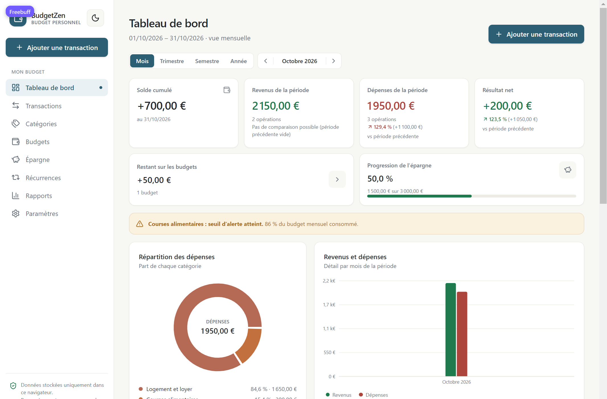
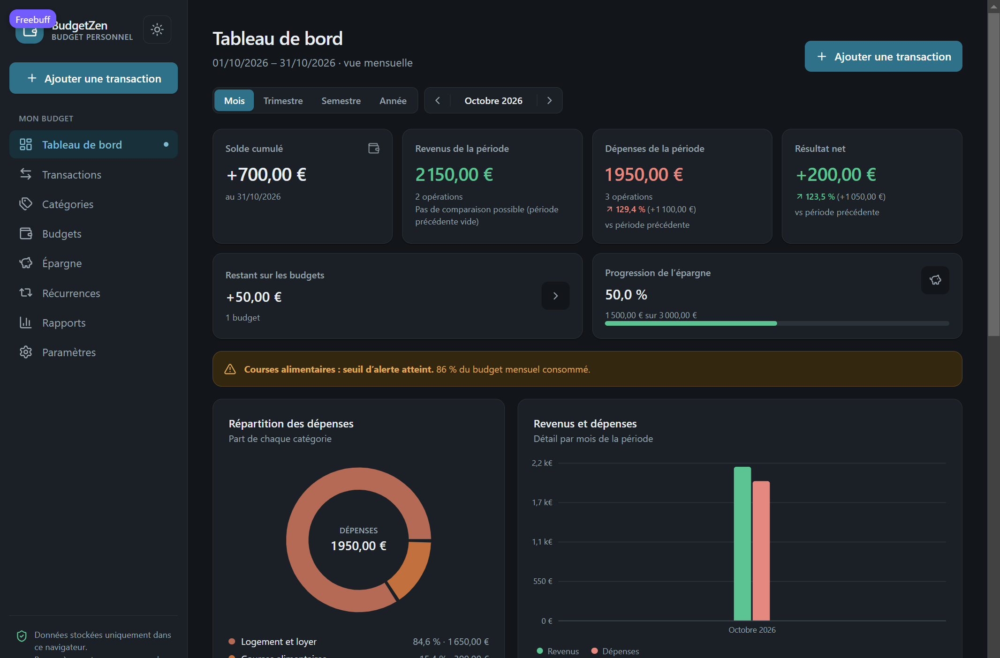

# BudgetZen

Application web de gestion de budget personnel, en français, en euros, pensée pour un usage individuel quotidien.

**Local-first** : toutes les données restent dans le navigateur (IndexedDB). Aucun compte, aucun serveur, aucune donnée financière transmise à un tiers. La sauvegarde/restauration JSON est le seul mécanisme de reprise en cas d'effacement du stockage du navigateur.

- Devise : EUR · format `1 250,50 €`
- Dates : `JJ/MM/AAAA` à l'affichage, `AAAA-MM-JJ` en stockage et dans les exports
- Fuseau : `Europe/Paris` (fixe pour cette version)
- Pages : Tableau de bord, Transactions, Catégories, Budgets, Épargne, Récurrences, Rapports, Paramètres
- Thèmes : clair et sombre, avec bascule instantanée et mémorisation locale
- En ligne : <https://yaopaulandr-creator.github.io/Budget-Zen/>

> **Vous découvrez l’application ?** Le [guide d’utilisation](GUIDE.md) détaille chaque écran pas à pas, de la première ouverture à la restauration d’une sauvegarde.





---

## 1. Démarrage

Prérequis : **Node.js `^20.19.0` ou `>=22.12.0`** et npm.

```bash
npm ci
npm run dev
```

L'application est servie sur `http://localhost:5173`.

### Scripts

| Commande | Rôle |
| --- | --- |
| `npm run dev` | Serveur de développement Vite |
| `npm run build` | Vérification TypeScript + build de production dans `dist/` |
| `npm run preview` | Prévisualisation du build de production |
| `npm run typecheck` | Vérification TypeScript seule |
| `npm run lint` | Analyse statique avec Oxlint |
| `npm run test` | Tests Vitest en mode watch |
| `npm run test:run` | Tests Vitest en exécution unique |

### Variables d'environnement

**Aucune.** Il n'y a ni clé API, ni secret, ni base distante. Ne jamais ajouter de secret dans ce projet frontend : tout ce qui est compilé est public.

---

## 2. Choix d'architecture : local-first

Deux options étaient possibles pour un usage strictement individuel : stockage local ou PostgreSQL/Supabase avec authentification. **La version locale a été retenue** pour livrer immédiatement une application réellement fonctionnelle, sans dépendance à un compte externe ni risque de fuite de données financières.

Conséquences, affichées dans l'interface et à assumer :

- les données sont liées **à ce navigateur et à cet appareil** ;
- effacer les données du site, utiliser une navigation privée ou changer d'appareil fait disparaître les données ;
- il n'y a **pas de synchronisation cloud ni de sauvegarde automatique** ;
- la sauvegarde JSON téléchargée est la seule copie de secours. Elle doit être testée en restaurant un fichier, pas seulement téléchargée.

Le code est séparé en une couche métier pure (`src/domain`), une couche de persistance (`src/storage`) et l'interface (`src/pages`, `src/components`). Une migration vers un backend consisterait à remplacer `src/storage/database.ts` et le store, sans réécrire les calculs.

---

## 3. Stack

- **React 19** + **TypeScript** + **Vite 8**
- **Tailwind CSS 4** (thème personnalisé, aucun composant UI externe)
- **Recharts** pour les graphiques
- **React Hook Form** + **Zod** pour les formulaires et la validation
- **idb** pour IndexedDB
- **jsPDF** pour les rapports PDF, **fflate** pour les fichiers XLSX
- **Vitest** + **Testing Library** (jsdom) pour les tests
- **Oxlint** pour l'analyse statique

---

## 4. Structure du projet

```
src/
  domain/        Logique métier pure, testable, sans React ni DOM
    money.ts       Montants en centimes, parsing/formatage fr-FR
    dates.ts       Dates ISO locales, formats français
    periods.ts     Mois, trimestres, semestres, années, périodes personnalisées
    finance.ts     Totaux, soldes, répartitions, comparaisons, budgets
    recurrence.ts  Échéanciers, génération idempotente des occurrences
    validation.ts  Schémas Zod, intégrité, version de sauvegarde
    backup.ts      Création, sérialisation et validation des sauvegardes
    defaults.ts    Catégories prédéfinies, paramètres par défaut
    demo.ts        Données de démonstration isolées et supprimables
  storage/       IndexedDB : ouverture, migration, écritures atomiques
  state/         AppStore : source de vérité, orchestration, erreurs/toasts
  lib/           CSV, XLSX, PDF, téléchargement
  components/    UI réutilisable, formulaires, graphiques, modales
  theme/         Contexte de thème, persistance clair/sombre, palettes des graphiques
  pages/         Une page par module
  test/          Configuration Vitest (fake-indexeddb, jest-dom)
```

---

## 5. Modèle de données (IndexedDB `budgetzen`, version 1)

Tous les montants sont des **entiers de centimes** (`amountCents`, `limitCents`, `targetCents`, `savedCents`, `initialBalanceCents`). Aucun calcul monétaire en flottant.

| Store | Champs principaux | Index |
| --- | --- | --- |
| `transactions` | `id`, `type` (`income`/`expense`), `amountCents` > 0, `transactionDate`, `categoryId`, `description`, `recurringOccurrenceId`, `createdAt`, `updatedAt` | `by-date`, `by-category` |
| `categories` | `id`, `name`, `type`, `icon`, `color`, `isDefault`, `isActive`, `createdAt`, `updatedAt` | `by-type` |
| `budgets` | `id`, `categoryId`, `limitCents`, `periodType` (`monthly`/`quarterly`/`semester`/`yearly`), `startDate` (ancre normalisée), `alertThresholdPercent`, `createdAt`, `updatedAt` | `by-category` |
| `savingsGoals` | `id`, `name`, `targetCents`, `savedCents`, `targetDate`, `description`, `status` (`active`/`achieved`/`archived`), `createdAt`, `updatedAt` | — |
| `recurringRules` | `id`, `type`, `amountCents`, `categoryId`, `description`, `frequency` (`weekly`/`monthly`/`quarterly`/`semester`/`yearly`), `startDate`, `endDate`, `nextOccurrenceDate`, `isActive`, `createdAt`, `updatedAt` | — |
| `occurrences` | `id`, `recurringRuleId`, `scheduledDate`, `transactionId`, `status` (`pending`/`confirmed`/`skipped`), `createdAt`, `updatedAt` | `by-rule`, `by-date` |
| `settings` | `id: 'settings'`, `initialBalanceCents`, `balanceReferenceDate`, `currency: 'EUR'`, `locale: 'fr-FR'`, `timezone: 'Europe/Paris'`, `autoConfirmRecurring`, `createdAt`, `updatedAt` | — |

Contraintes d'intégrité appliquées avant toute écriture ou restauration :

- type de transaction cohérent avec le type de la catégorie ;
- catégorie existante et active pour une nouvelle opération ;
- montants strictement positifs ;
- une occurrence est unique pour un couple `(règle, date prévue)` ;
- une occurrence confirmée pointe vers une transaction existante ;
- suppression d'une catégorie refusée si des transactions y sont rattachées (archivage proposé à la place) ;
- unicité du nom de catégorie par type.

### Création et migration du schéma

Le schéma est créé à l'ouverture par `openDB(..., DB_VERSION, { upgrade })` dans [`src/storage/database.ts`](src/storage/database.ts). Pour faire évoluer le schéma :

1. incrémenter `DB_VERSION` ;
2. ajouter le bloc de migration correspondant dans `upgrade` (création d'index, transformation de données) ;
3. incrémenter `BACKUP_SCHEMA_VERSION` dans `src/domain/validation.ts` si le format de sauvegarde change ;
4. conserver la compatibilité de lecture des sauvegardes antérieures (une sauvegarde de version supérieure est refusée explicitement).

---

## 6. Règles financières

Toutes les fonctions sont dans `src/domain` et couvertes par des tests.

- **Revenus / dépenses d'une période** : somme des montants dont la date appartient à `[début, fin[`.
- **Solde de la période** : revenus − dépenses.
- **Solde cumulé** : `solde initial + revenus − dépenses` depuis `balanceReferenceDate` jusqu'à la fin de la période consultée. Le solde initial n'est jamais compté comme un revenu.
- **Périodes calendaires** : bornes locales, début inclus, fin exclue. Mois de 28/29/30/31 jours, changements d'année, trimestres et semestres gérés par `addMonthsClamped` (le 31 janvier + 1 mois donne le 28/29 février).
- **Sous-périodes** : les décompositions mensuelles d'un trimestre, semestre ou année totalisent exactement le bilan principal (vérifié à l'écran et par les tests).
- **Répartition** : part = montant catégorie ÷ total du type × 100 ; affichage `—` si le total est nul, jamais de division par zéro.
- **Budgets** : consommé = dépenses de la catégorie sur le cycle du budget ; restant = plafond − consommé ; taux = consommé ÷ plafond. Seuils : atteint, proche, dépassé. Un dépassement alerte mais ne bloque jamais la saisie.
- **Épargne** : progression plafonnée à 100 % à l'affichage, montant réel conservé. Les objectifs ne modifient jamais le solde : seul un vrai mouvement d'argent le fait.
- **Récurrences** : les échéances sont générées à l'ouverture de l'application et à la demande. Chaque occurrence possède un identifiant déterministe `(règle, date)` : une échéance ne peut pas être créée deux fois. Les opérations futures non confirmées ne sont pas incluses dans les totaux réels. Une règle supprimée laisse ses transactions historiques intactes.

---

## 7. Fonctionnalités

### Tableau de bord
Solde cumulé, revenus, dépenses, résultat net, restant budgétaire, progression d'épargne, alertes, répartition et principales dépenses, comparaison avec la période précédente, dernières transactions. Sélecteur Mois / Trimestre / Semestre / Année avec navigation et retour à la période courante. Bouton permanent « Ajouter une transaction ».

### Transactions
Création, modification, suppression (confirmation), duplication. Formulaire avec type, montant > 0, date, catégorie filtrée par type, description. Recherche texte, filtres type/catégorie/période/dates/montants min-max/opérations récurrentes, tris date et montant, pagination. Nombre de résultats et totaux du périmètre filtré. État vide explicite et réinitialisation des filtres.

### Catégories
Catégories prédéfinies de revenus et de dépenses, création personnalisée avec icône et couleur, renommage, archivage/réactivation, consultation des opérations liées. Une catégorie utilisée ne peut pas être supprimée sans réaffectation ; les opérations passées ne sont jamais modifiées rétroactivement.

### Budgets
Plafond par catégorie de dépense, périodicité mensuelle, trimestrielle, semestrielle ou annuelle, seuil d'alerte configurable (80 % par défaut), consommation et restant calculés depuis les transactions, alertes visuelles.

### Épargne
Objectifs avec cible, montant suivi, date cible, description et statut. Progression, restant, effort mensuel estimé, contribution rapide, marquage comme atteint, archivage.

### Récurrences
Règles de revenus/dépenses hebdomadaires à annuelles, date de début, date de fin facultative, prochaine échéance, suspension/réactivation, suppression sans perte d'historique. Échéances en attente, confirmées ou ignorées, avec confirmation facultative à l'enregistrement.

### Rapports
Périodes mois, trimestre, semestre, année et personnalisée. Indicateurs, solde cumulé, détail par catégorie (montant, part, nombre d'opérations, variation), comparaison avec la période précédente, budgets du cycle, objectifs d'épargne, graphiques interactifs, historique des bilans annuels, décomposition par mois et par trimestre avec contrôle de cohérence des totaux.

### Graphiques
Anneau de répartition, histogramme revenus/dépenses, courbe du solde cumulé, barres de budgets, progression de l'épargne, tableau comparatif. Infobulles avec montants exacts, couleurs des catégories, états vides, aucun jeu de données fictif en dehors du mode démonstration clairement identifié.

### Apparence (thème clair / sombre)
Bascule lune/soleil dans la barre latérale et dans l'en-tête mobile, plus un choix explicite Clair/Sombre dans Paramètres → Apparence. Détails d'implémentation :

- toutes les couleurs de l'interface sont des jetons sémantiques définis une seule fois dans `src/index.css` (`--color-surface`, `--color-ink`, `--color-accent`…) ; le bloc `[data-theme='dark']` les redéfinit, donc aucune classe n'est dupliquée par thème ;
- deux jetons distincts évitent les contrastes dégradés : `accent` pour le texte et les traits, `accent-solid` pour les fonds colorés portant du texte blanc ;
- les graphiques Recharts ne peuvent pas hériter des variables CSS via des attributs SVG : ils lisent `useChartPalette()` (`src/theme/theme.ts`), ce qui les re-rend au changement de thème ;
- préférence stockée sous la clé `localStorage` `budgetzen-theme`, avec repli sur `prefers-color-scheme` à la première visite et synchronisation entre onglets ouverts ;
- un script inline dans `index.html` applique le thème avant le premier rendu, évitant tout flash clair au rechargement ;
- le thème n'est pas inclus dans la sauvegarde JSON : c'est une préférence d'affichage, pas une donnée financière.

### Exports
- **CSV** : séparateur `;`, UTF-8 avec BOM, dates ISO, montants décimaux, choix explicite entre périmètre filtré et totalité.
- **XLSX** : colonnes séparées Date / Type / Catégorie / Montant / Description / Récurrente, en-têtes stylés, montants en centimes convertis en euros.
- **PDF** : titre, période, date de génération, indicateurs, solde cumulé, graphique par sous-période, détail des revenus et dépenses par catégorie, budgets, objectifs, pagination.
- Les cellules texte sont neutralisées contre l'injection de formules (`=`, `+`, `-`, `@`) dans CSV et XLSX.
- Un message confirme chaque génération.

### Sauvegarde et restauration
Fichier JSON versionné (`app`, `schemaVersion`, `exportedAt`, `data`) contenant transactions, catégories, budgets, objectifs, règles, échéances, solde initial, date de référence et préférences.

- taille limitée à 10 Mo, JSON valide et schéma Zod strict ;
- contrôle d'intégrité des références et des doublons ;
- **aperçu détaillé avant remplacement** (compteurs, période couverte, solde initial) ;
- confirmation explicite obligatoire, remplacement complet uniquement (pas de fusion, pour éviter les doublons) ;
- un fichier invalide est rejeté sans toucher aux données existantes.

### Paramètres
Solde initial et date de référence, confirmation automatique des échéances, export de sauvegarde, restauration avec aperçu, chargement/suppression de données de démonstration, suppression totale des données locales, documentation des calculs.

---

## 8. Sécurité et confidentialité

- Aucune donnée financière ne quitte le navigateur ; aucun appel réseau métier.
- Aucun secret, aucune clé, aucun identifiant dans le code.
- Aucune authentification distante factice : l'application est locale par conception.
- Écritures IndexedDB séquencées et atomiques pour les opérations liées (suppression de transaction + occurrence, génération d'échéances).
- Validation Zod à l'entrée (formulaires et fichiers importés) et contrôles d'intégrité avant écriture.
- Exports assainis contre l'injection de formules ; descriptions affichées comme texte React (pas de HTML injecté).
- Messages d'erreur fonctionnels, sans détail interne sensible ; aucune donnée financière dans les journaux.
- Suppression des données : bouton « Supprimer toutes mes données » dans Paramètres, ou effacement du stockage du site dans le navigateur.

Limite à connaître : le stockage local n'est pas chiffré par l'application. La confidentialité repose sur la sécurité de l'appareil et du profil de navigateur.

---

## 9. Tests

```bash
npm run test:run
```

**99 tests, 10 fichiers, tous verts.**

| Fichier | Couverture |
| --- | --- |
| `src/domain/money.test.ts` | parsing/formatage fr-FR, centimes, arrondis, montants négatifs |
| `src/domain/periods.test.ts` | mois 28/29/30/31 jours, années, trimestres, semestres, bornes incluses/exclues, sous-périodes |
| `src/domain/finance.test.ts` | totaux, soldes, cumul, répartitions, comparaisons, budgets, épargne |
| `src/domain/recurrence.test.ts` | échéanciers hebdomadaires à annuels, mois courts, fin de règle, idempotence |
| `src/domain/backup.test.ts` | sérialisation, versions, fichiers invalides, intégrité, taille, aperçu |
| `src/domain/validation.test.ts` | montants nuls/négatifs/malformés, dates invalides, catégorie obligatoire, seuils, dates de règle |
| `src/lib/csv.test.ts` | contenu, séparateur, BOM, dates, injection de formules |
| `src/lib/xlsx.test.ts` | signature ZIP, feuille, colonnes, contenu |
| `src/lib/pdf.test.ts` | document PDF valide, cas vide, nom de fichier |
| `src/theme/theme.test.ts` | résolution de la préférence, priorité au choix enregistré, repli système, application au DOM, complétude des palettes |

Vérifications manuelles effectuées dans le navigateur : chargement des données de démonstration, navigation sur les huit pages, rapport annuel avec décomposition concordante, export CSV réellement téléchargé et relu, export PDF généré et téléchargé, sauvegarde JSON relue, rejet d'un fichier invalide, aperçu de restauration puis annulation sans modification des données (7 transactions avant et après), absence de débordement horizontal à 320, 375 et 768 px.

Non couvert par des tests automatisés : parcours Playwright de bout en bout, audit WCAG automatisé, test sur navigateurs autres que Chromium.

---

## 10. Déploiement

**En ligne : <https://yaopaulandr-creator.github.io/Budget-Zen/>** — publié automatiquement par GitHub Pages à chaque push sur `main`.

L'application est un site statique.

```bash
npm ci
npm run build
```

Le contenu de `dist/` peut être servi par n'importe quel hébergeur statique (Netlify, Vercel, GitHub Pages, Cloudflare Pages, nginx…). Le routage utilise `HashRouter`, donc **aucune règle de réécriture serveur n'est nécessaire**.

### GitHub Pages

Le workflow [`.github/workflows/deploy.yml`](.github/workflows/deploy.yml) installe les dépendances, exécute `typecheck` et les tests, construit le site puis publie `dist/` via l'artefact Pages. Il s'exécute à chaque push sur `main` ou manuellement depuis l'onglet *Actions*.

Un site de projet GitHub Pages est servi sous `/<dépôt>/` : le workflow passe donc `PAGES_BASE=/Budget-Zen/`, que `vite.config.ts` utilise comme `base`. En local, sans cette variable, l'application reste servie à la racine (`http://localhost:5173`). Pour reproduire un build Pages sur Windows :

```bash
MSYS_NO_PATHCONV=1 PAGES_BASE=/Budget-Zen/ npm run build
```

Recommandations : servir en **HTTPS**, envoyer `X-Content-Type-Options: nosniff`, et ne pas ajouter d'analytics ou de scripts tiers qui pourraient lire le DOM financier.

Aucune variable d'environnement à configurer, aucune migration serveur à exécuter.

---

## 11. Limites connues et restant à faire

**Terminé et vérifié**

- Transactions, catégories, budgets, épargne, récurrences, rapports, paramètres.
- Calculs en centimes, périodes à bornes semi-ouvertes, soldes et cumuls.
- Exports CSV, XLSX, PDF avec protection contre l'injection de formules.
- Sauvegarde JSON versionnée, validation, aperçu et restauration confirmée.
- Responsive et navigation mobile ; états vides, chargements, erreurs et confirmations.
- 99 tests unitaires verts, typecheck, lint et build.
- Thème clair et sombre : bascule, persistance, absence de flash au rechargement, graphiques et infobulles lisibles dans les deux modes.

**Non implémenté (volontairement hors périmètre de cette version)**

- Synchronisation multi-appareils et authentification (nécessiterait un backend et des politiques RLS).
- Import bancaire automatique.
- Fusion de sauvegardes (le remplacement complet est proposé à la place).
- Import CSV/XLSX de relevés existants.
- Génération des échéances en arrière-plan : elle a lieu à l'ouverture de l'application ou via le bouton de génération.
- Fuseau horaire configurable (fixé à `Europe/Paris`).
- Tests Playwright de parcours complets et audit d'accessibilité automatisé.

---

## 12. Journal de vérification

- `npm run typecheck` : OK
- `npm run lint` : 0 erreur, 15 avertissements (Fast Refresh, React Hook Form, effets de réinitialisation) sans impact fonctionnel
- `npm run test:run` : 99/99 tests, 10 fichiers (dont `src/theme/theme.test.ts`)
- `npm run build` : OK
- Vérification navigateur (Chromium, dev server) : rapports, exports, sauvegarde/restauration, responsive 320 → 1440 px.
- Thème : bascule depuis la barre latérale et Paramètres, persistance après rechargement (`localStorage` = `dark`), fond calculé `rgb(18, 22, 26)` en sombre et `rgb(247, 247, 243)` en clair, graphiques et infobulles recolorés, absence de débordement horizontal à 375 px.
